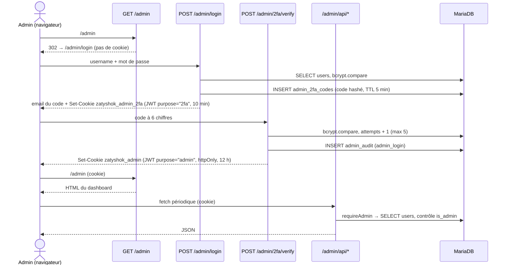

# Page Admin (Monitoring) — Zatyshok

> Feature doc — tableau de bord d'administration sur
> `https://api-zatyshok.esiah.dev/admin`.

## Vue d'ensemble

Une page **server-rendered** servie par le backend Express (même origine que
l'API, aucune dépendance front) permettant de monitorer les comptes, les
connexions, les **mises à jour des clients** et les actions d'administration.

Sections :

| Section | Contenu |
| --- | --- |
| Cartes | comptes (total / approuvés / en attente), actifs 7 j et 30 j, connexions et MAJ des 7 derniers jours, dernière release Gitea, version notifiée, taux d'adoption |
| Versions installées | répartition des clients par `app_version` (chips) |
| Comptes | thème, badges admin/actif/en attente, version, dernière connexion / activité, inscription + actions |
| Historique des MAJ | `app_updates` : user, `from → to`, date |
| Connexions récentes | `login_events` : user, IP, version, date |
| Journal d'audit | `admin_audit` : acteur, action, cible, date |
| Système | uptime du process, taille de la base, comptages par table |

Auto-refresh toutes les 60 s (fetch des API JSON), bouton **Actualiser**,
bouton **Vérifier la release** (interroge Gitea sans emailer), **Déconnexion**.

## Authentification

- **Mêmes identifiants que l'application** (aucun secret séparé) — le compte
  doit avoir `users.is_admin = 1` (migré par `001_admin_monitoring.sql` pour
  `esiah.dev@gmail.com`).
- **2FA par email** (`002_admin_2fa.sql`) : après le mot de passe, un code à
  6 chiffres (`crypto.randomInt`, hashé bcrypt) est envoyé par email. TTL
  5 min, 5 tentatives max, renvoi avec cooldown 60 s. Le cookie temporaire
  `zatyshok_admin_2fa` porte le claim `purpose="2fa"` ; `requireAdmin` exige
  `purpose="admin"` sur le cookie final.
- Cookies : `HttpOnly`, `SameSite=Lax`, `Path=/`, `Secure` hors localhost,
  expiration 12 h (session) / 10 min (attente 2FA).
- `is_admin` est **relu en base à chaque requête** : une rétrogradation prend
  effet immédiatement.
- Throttle : 10 échecs (mot de passe ou code) → `429` pendant 15 min (clé IP).

## Mécanisme de tracking (côté app, zéro changement client)

Le client envoie déjà `X-App-Version` sur chaque requête
(`frontend/src/renderer/src/services/apiClient.ts`). `authenticateToken`
(`backend/src/middlewares/auth.ts`) compare cette valeur à `users.app_version` :

| Cas | Effet |
| --- | --- |
| première version connue (`NULL`) | `users.app_version` + `last_seen_at` renseignés, **pas** d'événement |
| écart détecté | `INSERT INTO app_updates (from_version → to_version)` + mise à jour `users` |
| aucun écart | `last_seen_at` rafraîchi au plus toutes les 5 min |

Le `POST /login` écrit `last_login_at` + une ligne `login_events` (IP =
`CF-Connecting-IP`, version du header).

## Actions admin

| Action | Endpoint | Effet | Garde |
| --- | --- | --- | --- |
| Approuver | `POST /admin/api/users/:id/approve` | `isApproved = 1`, purge du token | — |
| Révoquer | `POST /admin/api/users/:id/revoke` | `isApproved = 0` (bloqué au login) | jamais soi-même |
| Promouvoir | `POST /admin/api/users/:id/admin` | `is_admin = 1` | pas de bouton (curl only) |
| Rétrograder | `POST /admin/api/users/:id/demote` | `is_admin = 0` | jamais soi-même |
| Vérifier la release | `POST /admin/api/check-release` | fetch GitHub (sans email) | journalisé |

Toutes les actions sont tracées dans `admin_audit`.

## Fichiers

| Rôle | Fichier |
| --- | --- |
| Routes, HTML, API, 2FA | `backend/src/routes/admin.ts` |
| Session cookie, throttle, `requireAdmin` | `backend/src/middlewares/admin.ts` |
| Tracking des versions | `backend/src/middlewares/auth.ts` (`trackClientState`) |
| Connexions | `backend/src/routes/auth.ts` (POST `/login`) |
| Schéma | `migrations/001_admin_monitoring.sql`, `migrations/002_admin_2fa.sql`, `init.sql` |
| Montage Express | `backend/src/index.ts` (`app.use("/admin", …)`) |

## Interface

- Thème sombre type Batman : `#0a0a0f / #14141f`, accent jaune `#f5c518`,
  police Quicksand, badges colorés, cartes de stats.
- Bilingue **FR/EN** via `Accept-Language` (libellés du dashboard, du login et
  du formulaire 2FA).
- Aucune donnée utilisateur injectée non échappée (`esc()` côté JS embarqué).

## Dépendances

- Schéma : migrations `001` + `002` appliquées (dev : `make migrate`, prod :
  automatique via `deploy.yml`).
- Releases : affiche la dernière release GitHub publique du dépôt
  (`fetchLatestGitHubRelease`).
