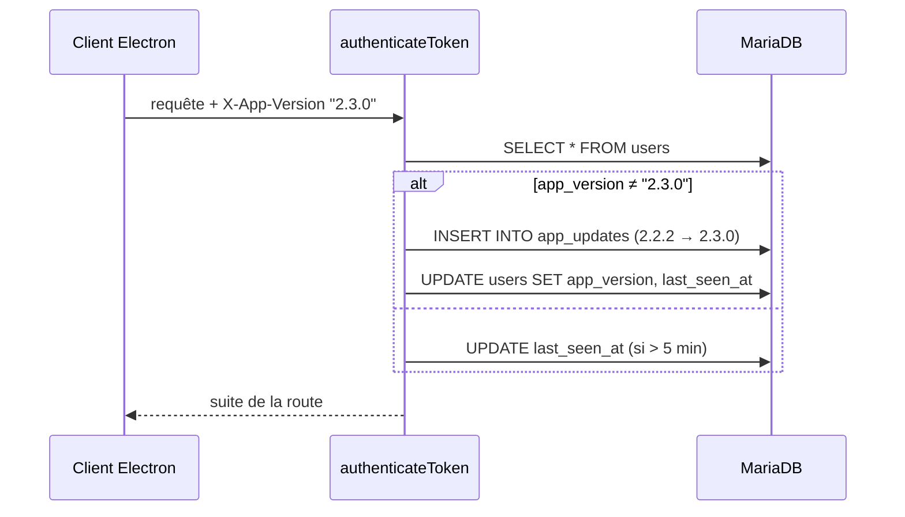

# API et modèle de données — Zatyshok

Base : `https://api-zatyshok.esiah.dev` (prod), `http://localhost:3000` (dev).
Fichiers statiques : `/uploads/*` (avatars, audios, icône).

## En-têtes

Toute route marquée **app** exige les trois couches vérifiées par
`backend/src/middlewares/auth.ts` :

| En-tête | Valeur | Sinon |
| --- | --- | --- |
| `X-App-Token` | `API_TOKEN` (partagé, `apiClient.ts`) | `401` |
| `X-App-Version` | version du client (`pkg.version`) | `426` si absente ou `< 1.1.0` |
| `Authorization` | `Bearer <JWT>` (30 j) | `401/403` |

Les routes **publiques** ne portent que `X-App-Token`/`X-App-Version` si le
client les envoie (aucune vérification serveur). Réponses d'erreur : JSON
`{ "error": "..." }` (message ou code court).

## Routes

### Publiques — session (`backend/src/routes/auth.ts`)

| Méthode | Chemin | Détail |
| --- | --- | --- |
| POST | `/register` | politique de mdp ≥ 16 car., maj., spécial ; envoie l'email d'approbation |
| POST | `/login` | identifiants → JWT + `role` + `userId` ; écrit `last_login_at` + `login_events` |
| GET | `/approve/:token` | active le compte (lien email) |
| POST | `/forgot-password` | code à 6 car. envoyé par email (1 h) |
| POST | `/reset-password` | code + nouveau mdp (même politique) |
| GET | `/open-app` | page deep-link `zatyshok://` |
| GET | `/` | landing + dernière release (cache `releaseService`) |

### App — compte (`backend/src/routes/user.ts`)

| Méthode | Chemin | Détail |
| --- | --- | --- |
| GET | `/user/me` | profil + stats (moods, goals, events, notes) |
| PATCH | `/user/update-info` | username / email (notification envoyée à la nouvelle adresse) |
| PUT | `/user/role` | thème visuel (him, her, art, artFR, music, musicFR, default) |
| POST | `/user/upload-profile` | avatar (multipart `image`) |
| PATCH | `/user/update-password` | mdp actuel requis |

### App — modules

| Méthode | Chemin | Détail |
| --- | --- | --- |
| GET/POST | `/calendar` | entrées (note / goal / event, texte ou audio) |
| POST | `/calendar/upload-audio` | audio (multipart `audio`) |
| PATCH/DELETE | `/calendar/:id` | modification / suppression |
| GET/POST | `/moods` | humeur du jour (unique par user + date) |
| GET | `/weather` | publique ; IP lue dans `CF-Connecting-IP`, refus des IP privées |
| GET | `/spotify/login/:username` | publique, OAuth |
| GET | `/spotify/callback` | publique, OAuth |
| GET | `/spotify/current` | titre en cours |
| PUT | `/spotify/pause\|play\|next\|previous` | transport |
| GET/POST | `/budget/categories` | catégories |
| GET/POST | `/budget/expenses` | transactions |

### Administration — `role` = `is_admin` (`backend/src/routes/admin.ts`)

Authentification distincte de l'app : **cookie `zatyshok_admin`** (JWT httpOnly,
12 h, `SameSite=Lax`, `Secure` hors localhost) posé par `POST /admin/login`
(identifiants du compte, `bcrypt`, `is_admin = 1` exigé). Le HTML est servi par
le même serveur : `GET /admin` (redirige vers `/admin/login` sans session).

| Méthode | Chemin | Rôle |
| --- | --- | --- |
| GET | `/admin` | page de monitoring (server-rendered) |
| GET | `/admin/login` | formulaire de connexion |
| POST | `/admin/login` | `429` après 10 essais / 15 min / IP |
| POST | `/admin/logout` | efface le cookie |
| GET | `/admin/api/overview` | cartes (comptes, actifs 7/30 j, MAJ, releases), versions installées, adoption, uptime, taille + counts des tables |
| GET | `/admin/api/users` | comptes : thème, admin, approuvé, version, dernière connexion / activité, inscription |
| GET | `/admin/api/activity` | 30 dernières connexions (`login_events`), MAJ (`app_updates`), actions admin (`admin_audit`) |
| POST | `/admin/api/users/:id/approve` | approuve (remplace le lien email) |
| POST | `/admin/api/users/:id/revoke` | bloque un compte (jamais soi-même) |
| POST | `/admin/api/users/:id/admin` | promeut admin |
| POST | `/admin/api/users/:id/demote` | rétrograde (jamais soi-même) |
| POST | `/admin/api/check-release` | interroge Gitea (sans emailer), journalisé |

Chaque action est écrite dans `admin_audit` (acteur, action, cible, IP).

### Suivi passif des majs

Aucune route dédiée : à **chaque requête app**, `authenticateToken` compare
`X-App-Version` à `users.app_version` :

- écart → `INSERT INTO app_updates (from_version, to_version)` + `UPDATE users
  SET app_version, last_seen_at = NOW()` ;
- pas d'écart → refresh `last_seen_at` au plus toutes les 5 minutes.

Le login écrit `login_events` (`user_id`, `ip`, `app_version`).

## Droits et isolation

- Toutes les requêtes métier vérifient `user_id` en SQL (règle IDOR,
  `agents.md`) : jamais de lecture/écriture croisée entre comptes.
- Les routes admin repassent par `requireAdmin` (cookie **et** `is_admin`
  relu en base à chaque appel — la révocation est immédiate).
- `404`/`401` plutôt que des détails sur l'existence d'une ressource.

## Modèle de données

`init.sql` = base vierge complète ; `migrations/*.sql` = compléments
**idempotents** appliqués à chaque déploiement (`make migrate` /
`make prod-migrate`, bouclé par `deploy.yml`).

| Table | Rôle |
| --- | --- |
| `users` | comptes : `role` = thème, `isApproved`, `is_admin`, `app_version`, `last_login_at`, `last_seen_at`, `created_at`, tokens reset/approval, Spotify |
| `system_settings` | `last_notified_version` (monitoring releases) |
| `calendar_entries` | planner (note / goal / event, texte / audio, récurrence) |
| `mood_entries` | humeurs (unique user + date) |
| `budget_categories`, `transactions` | budget |
| `login_events` | historique des connexions (IP, version) |
| `app_updates` | qui a mis à jour, X → Y, quand |
| `admin_audit` | actions admin (acteur, cible, détail) |

| Migration | Contenu |
| --- | --- |
| `migrations/001_admin_monitoring.sql` | colonnes `users` (`created_at`, `last_login_at`, `last_seen_at`, `app_version`, `is_admin`), tables `login_events` / `app_updates` / `admin_audit`, promeut `esiah.dev@gmail.com` en admin |

> Une migration appliquée **ne se modifie jamais** : passer par un nouveau
> numéro `00N_*.sql`. Les gardes `IF NOT EXISTS` rendent le rejeu sans danger.

## Erreurs métier

| Code | Sens |
| --- | --- |
| `400` | champs manquants / invalide (mdp, id) |
| `401` | token app ou JWT absent/invalide, mauvais identifiants admin |
| `403` | compte non approuvé / introuvable / non admin |
| `426` | version cliente obsolète |
| `429` | login admin limité (10 / 15 min / IP) |
