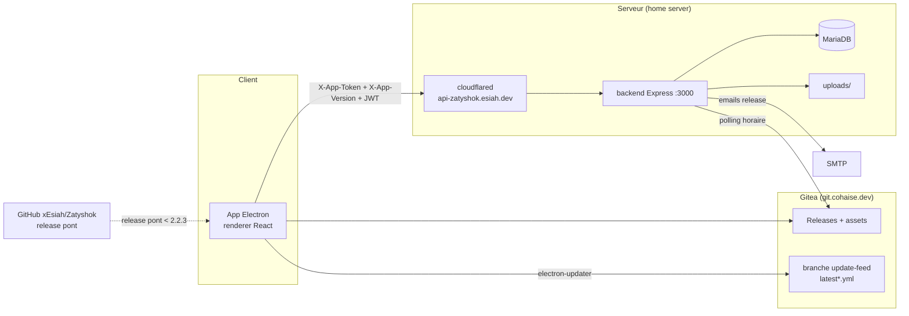
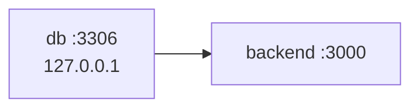

# Architecture — Zatyshok

Application desktop « cozy » de gestion du quotidien : Planner (goals / events /
thoughts), Mood Tracker, Budget, Hub multimédia (Spotify / Météo). Une app
Electron, une API Node/Express, une base MariaDB, des releases auto-uploadées
sur Gitea, et une page d'administration monitorée sur l'API.

## Pile

| Élément | Où |
| --- | --- |
| Electron 39 + React 19 + Vite 7 (electron-vite) + Tailwind 4 + react-router-dom 7 | `frontend` |
| Express 5 + TypeScript (module Node16) | `backend/src` |
| MariaDB (`mysql2`) | `backend/src/config/db.ts` |
| JWT (`jsonwebtoken`) + bcrypt | `backend/src/middlewares/auth.ts` |
| Nodemailer | `backend/src/routes/auth.ts` |
| electron-updater | `frontend/src/main` (auto-update) |
| cloudflared (tunnel) | `docker-compose.prod.yml` |

## Découpage

```
frontend/src/main/          process Electron (fenêtre, updater, IPC)
frontend/src/preload/       pont renderer ↔ Electron (seule porte d'accès OS)
frontend/src/renderer/      React (pages, services/apiClient.ts, locales, contexts)
backend/src/routes/         métiers : auth, user, calendar, moods, weather, spotify, budget, admin
backend/src/middlewares/    auth (app + JWT + tracking), admin (session cookie admin)
backend/src/services/       releaseService (monitor Gitea → emails)
backend/src/config/         db (pool), emailTemplates.json
migrations/                 SQL idempotent appliqué par make migrate / deploy.yml
init.sql                    schéma complet pour une base vierge
docs/                       documentation (source de vérité avec agents.md)
.github/workflows/          release.yml (MAJ), deploy.yml (CD), auto-pr.yml
```

Tout le backend tient dans un seul paquet, sans workspace. `backend/dist` est
gitignoré : le Dockerfile compile via `npm run build` (tsc) en multi-stage.

## Schéma global



## Chaîne de démarrage

**Prod** (`docker-compose.prod.yml`, projet `zatyshok-prod`) :



- `db` (mariadb:10.11) : healthcheck `mysqladmin ping`, bind mount `../zatyshok-db-data`.
- `backend` : image buildée (tsc en builder), `node dist/index.js`, `depends_on db healthy`.
- Le tunnel Cloudflare est dans un stack indépendant (`/srv/apps/tunnel`) et
  rejoint le réseau externe `zatyshok-prod_app-network`.
- Déploiement : `deploy.yml` (runner self-hosted) → `git pull` + `make prod-migrate` +
  `make prod-build` + `make prod-up`.

**Dev** (`docker-compose.yml`, projet `zatyshok-dev`) : `db` (`3306:3306`) +
`backend` (`3000:3000`, build local). Le front tourne hors Docker :
`make dev-front` (`electron-vite dev`, serveur Vite `5173`).

## Authentification et en-têtes

Trois couches sur chaque requête protégée (`backend/src/middlewares/auth.ts`) :

1. `X-App-Token` : jeton applicatif partagé (`API_TOKEN`) — `401` sinon.
2. `X-App-Version` : version cliente (`pkg.version` via `apiClient.ts`) — `426`
   si absente ou `< 1.1.0`.
3. `Authorization: Bearer <JWT>` (30 j) — `401/403` sinon.

La session est stockée côté client dans `electron-store`
(`user_token`). Le login (`POST /login`) renvoie aussi `role` (thème visuel) et
`userId`.

> `users.role` est le **thème** (him / her / art / artFR / music / musicFR /
> default), **pas** un rôle de sécurité. L'administration repose sur
> `users.is_admin`.

## Monitoring et administration

Le middleware d'auth charge la ligne `users` à chaque requête et la compare à
`X-App-Version` : tout écart déclenche un enregistrement dans `app_updates`
(« qui a mis à jour, de quelle version vers quelle version ») et un refresh de
`last_seen_at` (throttle 5 min). Le login écrit `last_login_at` + une ligne
`login_events` (IP lue dans `CF-Connecting-IP`).

La page **`/admin`** (server-rendered, même origine que l'API) expose la vue
d'ensemble, les comptes, l'historique des MAJ, les connexions et le journal
d'audit — voir [`api.md`](api.md) et [`security.md`](security.md).

## Releases et auto-update

- Les tags `vX.Y.Z` déclenchent `release.yml` : build win/mac/linux (GitHub
  Actions) → release **GitHub (pont)** + release **Gitea** (assets + réécriture
  des `latest*.yml` vers le CDN Gitea) + commit de feed sur la branche
  `update-feed`.
- `app-update.yml` gravé au build pointe (clients ≥ 2.2.3) vers le feed Gitea
  `.../raw/branch/update-feed` ; les clients ≤ 2.2.2 restent branchés sur
  l'API GitHub (`xEsiah/Zatyshok`) — d'où la release pont obligatoire.
- Côté serveur, `releaseService` interroge l'API Gitea toutes les heures et
  emaille les comptes approuvés quand le minor/major change
  (`system_settings.last_notified_version`).

## Limites connues

- `npm run dev` backend (`ts-node-dev` + TS 5.9) ne résout pas les imports
  `./routes/*.js` : utiliser Docker (`make dev-backend`) ou
  `npm run build && node dist/index.js` (voir [`workflow.md`](workflow.md)).
- Pas de framework de test ni de migration versionnée « à l'ancienne » : les
  migrations sont **idempotentes** (`IF NOT EXISTS`), rejouées à chaque
  déploiement.
- `docs/` est la référence ; un README de paquet peut décrire un état antérieur.
