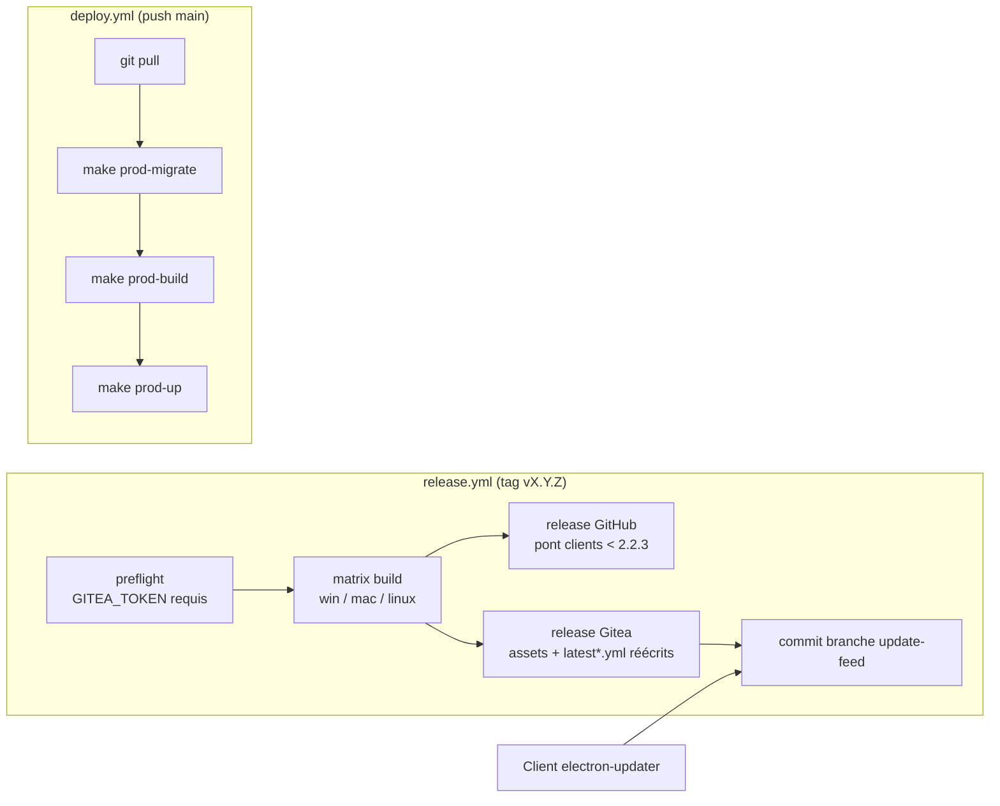

# Déploiement — Zatyshok

## Démarrer (dev)

```sh
cp .env.example .env    # renseigner toutes les clés
make dev-up             # db + backend Dockerisés
make dev-front          # app Electron (Vite 5173)
make migrate            # migrations idempotentes (si nouvelles)
```

API sur `http://localhost:3000`, base sur `localhost:3306`.

## Variables (`.env` à la racine, jamais versionné)

| Variable | Rôle |
| --- | --- |
| `DB_HOST` / `DB_USER` / `DB_PASSWORD` / `DB_NAME` | base applicative (`db` = hôte Docker) |
| `DB_ROOT_PASSWORD` | root MariaDB (healthcheck, sauvegardes) |
| `API_TOKEN` | jeton applicatif (`X-App-Token`), aussi `VITE_API_TOKEN` côté front |
| `API_URL` | URL publique de l'API (liens email : approbation, ouverture app) |
| `JWT_SECRET` | signature des JWT (app **et** cookie admin) |
| `ID_TUNNEL` / `TUNNEL_TOKEN` | tunnel cloudflared managé |
| `SMTP_HOST` / `SMTP_PORT` / `SMTP_USER` / `SMTP_PASS` | envoi d'emails |
| `WEATHER_API_KEY` | météo |
| `SPOTIFY_CLIENT_ID` / `SPOTIFY_CLIENT_SECRET` / `SPOTIFY_REDIRECT_URI` | Spotify OAuth |
| `VITE_API_URL` / `VITE_API_TOKEN` | build front |
| `GH_TOKEN` | workflows GitHub (`auto-pr`) |

> Le backend charge `.env` **depuis la racine du repo** (relatif à `dist/` ou
> `src/`). Les variables déjà présentes dans l'environnement (ex. overrides de
> test) ne sont pas écrasées.

## Services

| Compose | Service | Port | Rôle |
| --- | --- | --- | --- |
| dev | `db` | `3306:3306` | MariaDB 10.11, bind mount `./zatyshok-db-data` |
| dev | `backend` | `3000:3000` | build local, `env_file: .env`, uploads montés |
| prod | `db` | `127.0.0.1:3306` | idem, bind mount `../zatyshok-db-data` |
| prod | `backend` | `3000:3000` | image `zatyshok-backend:latest` (multi-stage tsc) |
| prod | `tunnel` | — | `cloudflared` managé (`TUNNEL_TOKEN`), dépend de `backend` |

Le backend refuse de démarrer sans base saine (`depends_on: service_healthy`).

## Commandes Makefile

```sh
make help 2>/dev/null || grep -E '^[a-z-]+:' Makefile   # cibles disponibles
make dev-up / dev-down / dev-backend / dev-logs / dev-front
make prod-build / prod-up / prod-down / prod-logs / prod-restart
make migrate         # migrations/ → base dev
make prod-migrate    # migrations/ → base prod (container zatyshok-db)
make seed            # init.sql + datas.sql → base dev
make db-shell        # shell mariadb (dev)
make release         # gh workflow run deploy.yml
```

`migrate` / `prod-migrate` bouclent sur `migrations/*.sql` et s'appuient sur
des fichiers **idempotents** (`IF NOT EXISTS`) : rejeu sûr à chaque exécution.
Les identifiants sont lus depuis `.env` par le Makefile (jamais dans la
commande ni dans le dépôt).

## Intégration continue / déploiement continu

Le dépôt vit sur **GitHub** (`xEsiah/Zatyshok`) — bridge de release — et sur
**Gitea** (`git.cohaise.dev/Esiah/Zatyshok`) — source de vérité. Les workflows
sont dans `.github/workflows/` :



| Workflow | Déclencheur | Rôle |
| --- | --- | --- |
| `release.yml` | tag `v*` | preflight (`GITEA_TOKEN` **obligatoire**, validé via API Gitea), builds, release pont GitHub + release Gitea + feed `update-feed` |
| `deploy.yml` | push `main` (`backend/**`, `migrations/**`, compose, Makefile, workflow) ou manuel | runner self-hosted : `git pull` → `make prod-migrate` → `make prod-build` → `make prod-up` → prune |
| `auto-pr.yml` | push hors `main` | ouverture automatique de PR |

### Serveur d'application

- Chemin : `/srv/apps/zatyshok/Zatyshok` (runner self-hosted installé dessus).
- Le `git pull` de `deploy.yml` utilise le remote **`origin` du serveur** :
  le pointer vers Gitea (`https://git.cohaise.dev/Esiah/Zatyshok.git`, dépôt
  public) — le pont GitHub reste en place le temps de la transition des
  clients ≤ 2.2.2.
- `.env` et Docker sont présents sur le serveur ; aucun secret de base de
  données dans les workflows (le Makefile lit `.env` sur place).

### Secrets GitHub

| Secret | Workflow | Usage |
| --- | --- | --- |
| `GITEA_TOKEN` | `release.yml` | création de release + upload d'assets + commit de feed sur Gitea (portée `repo`) |
| `GH_TOKEN` | `auto-pr.yml` | API GitHub (PR) |

> Ne jamais taguer sans `GITEA_TOKEN` : le job `preflight` échoue exprès et
> empêche une release à moitié publiée.

## Exposition — Cloudflare Tunnel

- Tunnels managés par token : `docker-compose.prod.yml` lance
  `cloudflared tunnel run` avec `TUNNEL_TOKEN` — l'ingress
  (`api-zatyshok.esiah.dev` → `backend:3000`) se configure dans le dashboard
  Cloudflare (Zero Trust → Tunnels).
- L'API lit l'IP réelle via `CF-Connecting-IP` (CORS, throttle admin,
  `login_events`, météo) : indispensable de garder Cloudflare en frontal.
- Le certificat TLS et le cache sont assurés par Cloudflare ; ne pas exposer
  autre chose publiquement. `db` n'est publié que sur `127.0.0.1` (prod).

## Sauvegardes

Pas de cible dédiée : dump manuel via la base dev/prod, ex. sur le serveur :

```sh
docker exec -i zatyshok-db sh -c 'exec mariadb-dump -u"$MYSQL_USER" -p"$MYSQL_PASSWORD" "$MYSQL_DATABASE"' > zatyshok-$(date +%F).sql.gz
```

`make seed` et `make reset-db` (dev) **détruisent** des données : `reset-db`
supprime le dossier `zatyshok-db-data` (sudo requis) avant de repartir de
`init.sql` + `datas.sql`.

## Migrations en production

1. Changer le schéma = nouveau `migrations/00N_*.sql` idempotent (+ miroir
   `init.sql`).
2. Push `main` → `deploy.yml` l'applique (`make prod-migrate`) avant le
   rebuild, à chaque déploiement.
3. Vérifier : sur le serveur,
   `docker exec -i zatyshok-db mariadb -u "$DB_USER" -p"$DB_PASSWORD" "$DB_NAME" -e "SHOW COLUMNS FROM users LIKE 'is_admin'"`.
4. En dev : `make migrate` (déjà joué sur la base de test).
