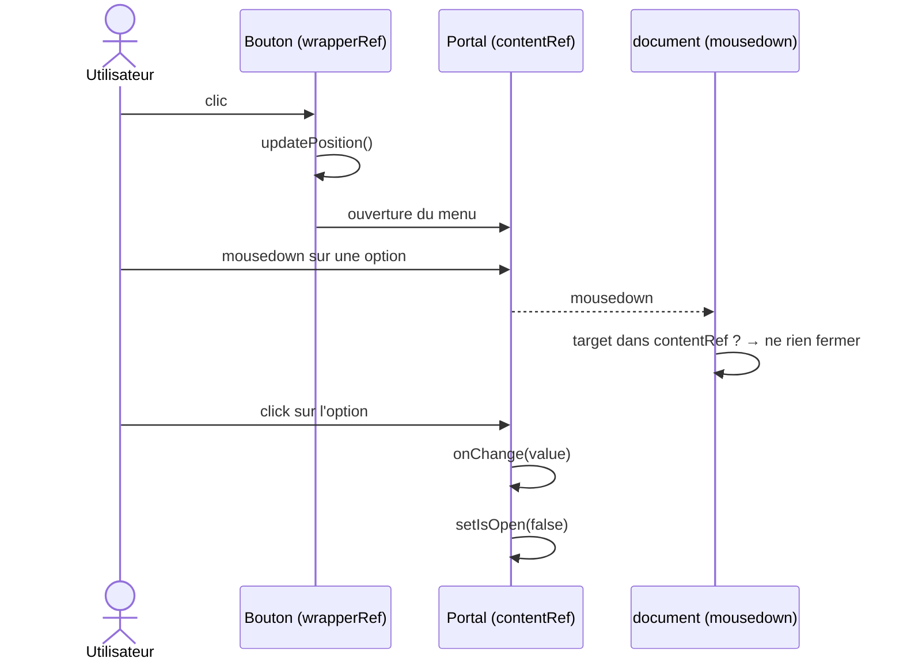

# Dropdown (composant UI)

> Composant de sélection réutilisable — `frontend/src/renderer/src/components/ui/Dropdown.tsx`.

## Vue d'ensemble

`Dropdown` affiche un bouton fermé avec l'option sélectionnée, puis un menu
d'options rendu dans un **portal** sur `document.body` pour échapper aux
conteneurs `overflow` (cartes, vues scrollables, mode édition du DailyView).

Il est utilisé notamment pour :

- le **type d'entrée** (`goal` / `event` / `note`) et la **récurrence**
  (`daily` / `weekly` / `monthly` / `yearly`) dans `DailyView` ;
- le type d'entrée et la récurrence dans `WriteView` ;
- les catégories de budget et le thème du profil.

## Comportement

- Le clic sur le bouton ouvre/ferme le menu (sauf si `disabled`).
- Le menu est positionné sous le bouton et suit le scroll et le redimensionnement.
- Un clic en dehors du bouton **et** du menu ferme le menu.
- Le choix d'une option appelle `onChange(value)` puis ferme le menu.

## Flux de sélection

## Point d'attention

Le menu étant dans un portal, il **n'est pas** contenu dans le wrapper du
bouton. La détection de clic extérieur doit donc vérifier deux refs :

| Ref | Rôle |
| --- | --- |
| `wrapperRef` | bouton + conteneur local |
| `contentRef` | menu portalisé sur `document.body` |

Vérifier uniquement `wrapperRef` ferme le menu dès le `mousedown` sur une option,
avant que le `click`/`onChange` ne soit exécuté : la sélection est ignorée et le
menu se ferme, ce qui donne l'impression que les clics ne sont pas pris en
compte.
